# Misdeal — галерея утверждённых боевых арен

**Дата сверки:** 2026-10-19. **Источник истины:** `scripts/battle/authored_backdrop.gd` (production `ARENA_PATHS`). Ниже представлены **16 активных игровых арен** в оригинальном размере **1280×720**, без персонажей и интерфейса. Альтернативные, архивные и отвергнутые QA-варианты не включены.

> Файлы в `docs/arena_gallery/*.webp` — точные, без перерисовки, бинарные экспорты исходных runtime `.webp.b64`. Они добавлены только для просмотра галереи; игровые ссылки и логика не изменены.

## Основной утверждённый пакет — 10 арен

### Склеп · `crypt`

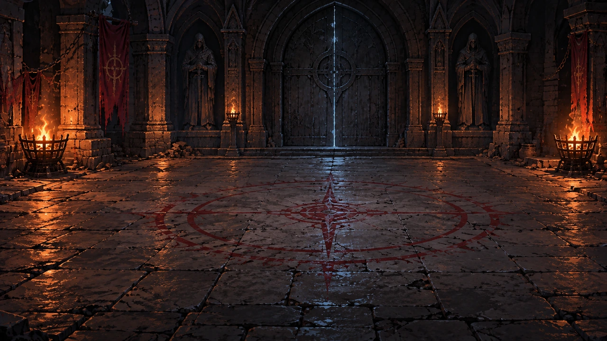

[Открыть оригинал](../assets/pixel/battle/arenas/arena_redraw_v2/crypt.webp)

### Кладбище · `graveyard`

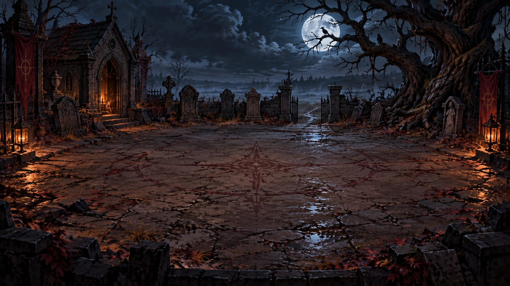

[Открыть оригинал](../assets/pixel/battle/arenas/arena_redraw_v2/graveyard.webp)

### Виселица · `gallows`

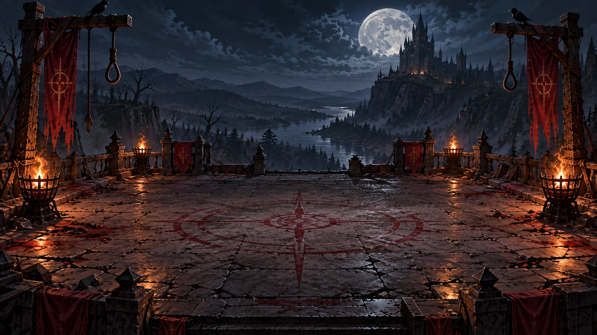

[Открыть оригинал](../assets/pixel/battle/arenas/arena_redraw_v2/gallows.webp)

### Костница · `ossuary`

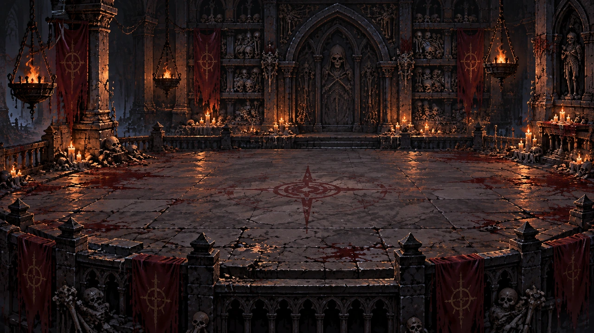

[Открыть оригинал](../assets/pixel/battle/arenas/arena_redraw_v2/ossuary.webp)

### Костяной надзиратель · `warden`

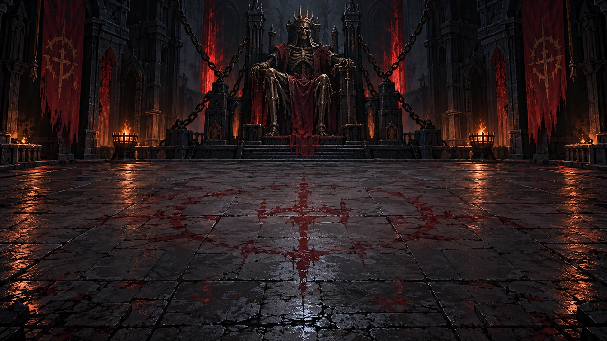

[Открыть оригинал](../assets/pixel/battle/arenas/arena_redraw_v2/warden.webp)

### Костяная дробилка · `bone_crush`

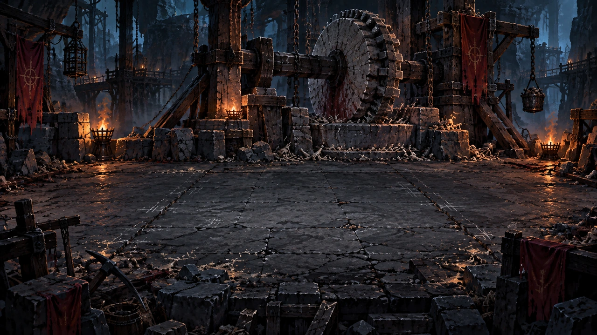

[Открыть оригинал](../assets/pixel/battle/arenas/arena_redraw_v2/bone_crush.webp)

### Костяной рой · `bone_swarm`

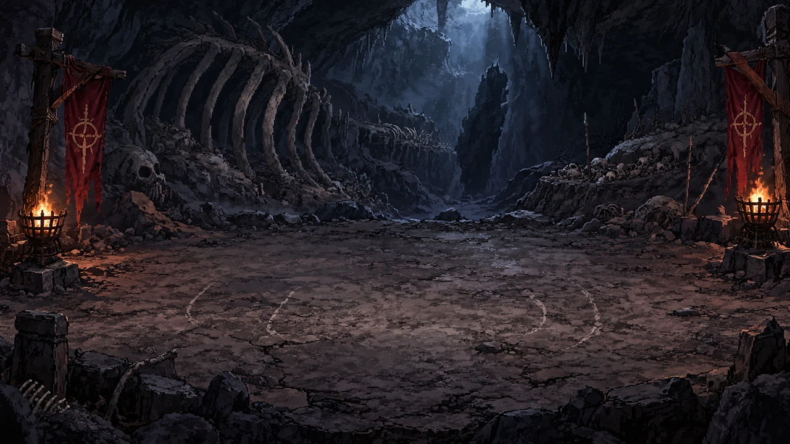

[Открыть оригинал](../assets/pixel/battle/arenas/arena_redraw_v2/bone_swarm.webp)

### Могильный перекрёсток · `grave_crossfire`

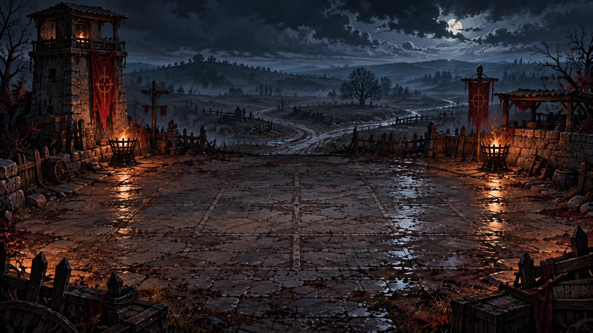

[Открыть оригинал](../assets/pixel/battle/arenas/arena_redraw_v2/grave_crossfire.webp)

### Железная стена · `iron_wall`

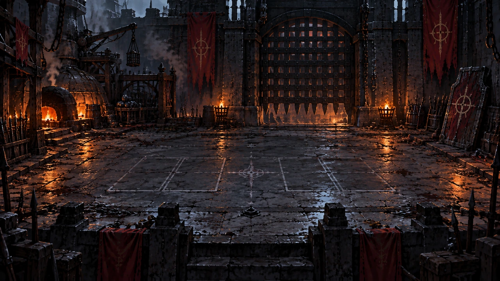

[Открыть оригинал](../assets/pixel/battle/arenas/arena_redraw_v2/iron_wall.webp)

### Последний колокол · `last_bell`

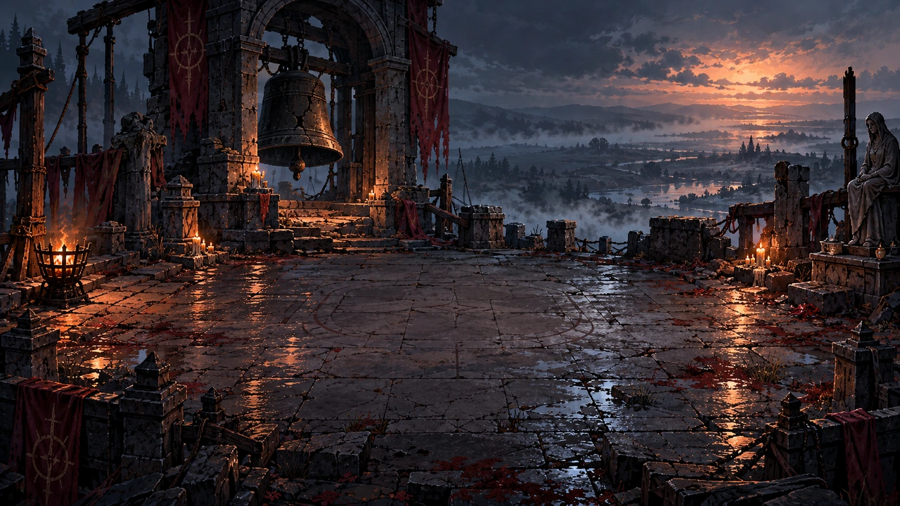

[Открыть оригинал](../assets/pixel/battle/arenas/arena_redraw_v2/last_bell.webp)

## Дополнительные арены — 6

### Расстрельная площадь · `firing_square`

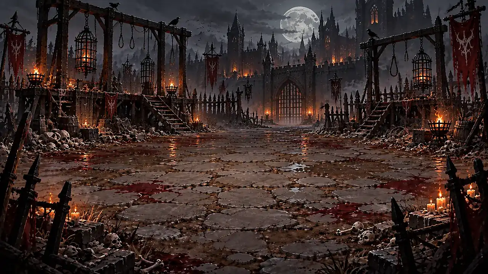

[Открыть изображение](arena_gallery/firing_square.webp) · [Runtime-источник](../assets/pixel/battle/arenas/arena_redraw_v1/firing_square.webp.b64)

### Костяной ритуал · `bone_ritual`

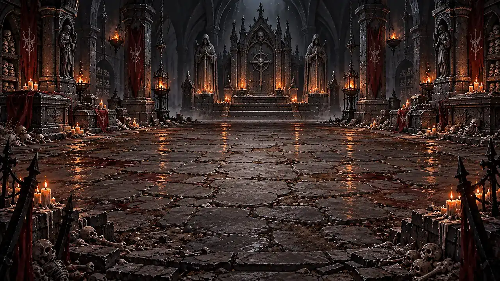

[Открыть изображение](arena_gallery/bone_ritual.webp) · [Runtime-источник](../assets/pixel/battle/arenas/arena_redraw_v1/bone_ritual.webp.b64)

### Обветшавший театр · `threadbare_theatre`

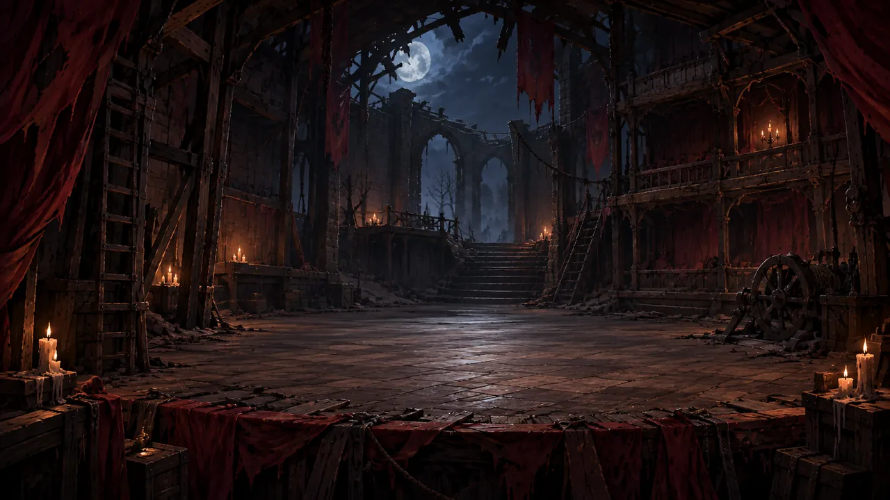

[Открыть изображение](arena_gallery/threadbare_theatre.webp) · [Runtime-источник](../assets/pixel/battle/arenas/threadbare_theatre_approved_v1.webp.b64)

### Чёрная переправа — штормовой причал · `black_crossing`

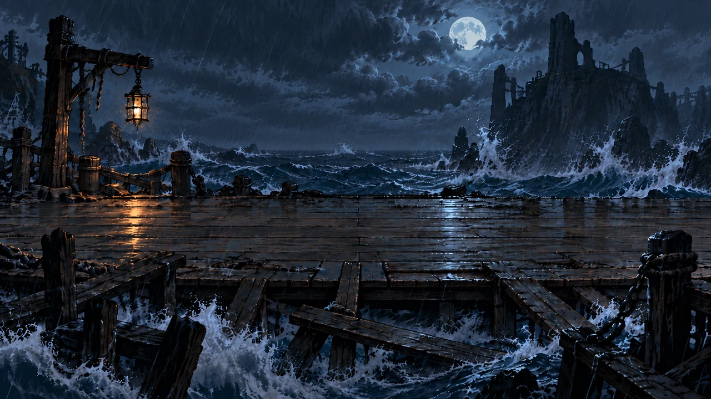

[Открыть изображение](arena_gallery/black_crossing.webp) · [Runtime-источник](../assets/pixel/battle/arenas/black_crossing_storm_pier_approved_v1.webp.b64)

### Дорога чёрных фонарей · `black_lantern_road`

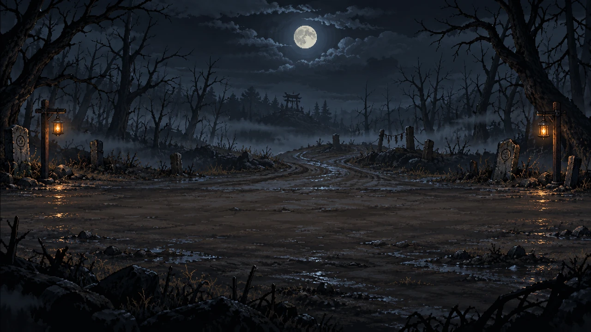

[Открыть изображение](arena_gallery/black_lantern_road.webp) · [Runtime-источник](../assets/pixel/battle/arenas/black_lantern_road_arena_selected_v1.webp.b64)

### Суд безмолвных · `court_of_the_mute`

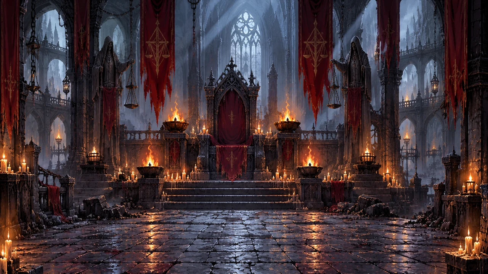

[Открыть изображение](arena_gallery/court_of_the_mute.webp) · [Runtime-источник](../assets/pixel/battle/arenas/court_of_the_mute_d271_painted_qa.webp.b64)

## Контрольные сведения

- Основной набор из десяти фонов утверждён по `docs/ARENA_REVIEW_2026_10_11.md` и подключён из `arena_redraw_v2`.
- `firing_square` и `bone_ritual` подключены из `arena_redraw_v1`; их более ранний визуальный статус не нужно путать с новым v2.
- Театр, переправа и дорога используют отдельные выбранные/утверждённые файлы. Суд безмолвных использует D271 — расписанный фон, принятый пользователем после отклонения схематичной D270.
- Все 16 слотов соответствуют актуальному `ARENA_PATHS`. Галерея **не** меняет фон в Godot, игровые границы/пол, баланс и порядок боя.
