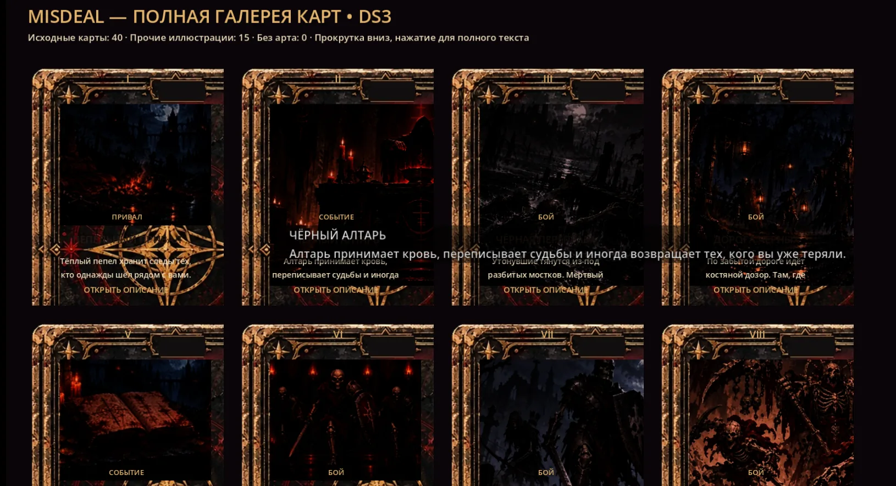

# D317 — First real Godot DS3 card gallery screenshot: failed visual QA and new-chat handoff (2026-10-21)

## Primary evidence (committed, not an inferred screenshot)

- Original provided in this conversation as a **1630×886 PNG**; optimized full-size 1630×886 screenshot archived in GitHub as `docs/qa/D317_card_ds3_gallery_user_screenshot.webp` (WebP byte SHA-256 `17b7dd7762707b5dbc29f8b3049036722d5c8650ec03d36ac66d075ac262625f`). This is a *real user's Godot screenshot*, not image-generation concept.
- Visible header: **«MISDEAL — ПОЛНАЯ ГАЛЕРЕЯ КАРТ • DS3»**, **«Исходные карты: 40 · Прочие иллюстрации: 15 · Без арта: 0»**. These counts establish that art textures can be resolved for the gallery; they do **not** mean the illustrations, labels or layouts are visually approved.
- The user then said **«Так посмотри мой ответ. Сохрани контекст - продолжим в новом чате»**. This is the latest feedback; they did **not** approve the result.

## Visible quality failures — highest-priority next task

1. **Severe card text overflow / overlap.** The second card's narrative, `«Алтарь принимает кровь, переписывает судьбы...»`, crosses adjacent cards and other UI; title, description and category sections are visually colliding. Text inside several cards is not confined to its correct dedicated card panel.
2. **Long content in wrong context.** Cards contain raw multi-sentence narrative copy as though it were a compact caption; the gallery has only an `«ОТКРЫТЬ ОПИСАНИЕ»` hint, but users cannot visually parse the cards before opening them. Clicking currently writes an entire description into the global small summary label rather than displaying a proper full-text reader. Must preserve canonical full text while offering an uncluttered brief/ellipsis summary on the face and readable independent detail view.
3. **Title/type/ornament misalignment.** Empty dark plates at card tops, Roman decorative tabs and category strips interrupt the illustrated area. Name and type seem superimposed on art rather than staying in the parchment title well, especially for long names.
4. **Artwork too dim.** Many scene illustrations are nearly black in the gallery, with low subject clarity. Current grading does not achieve the user-approved high-contrast saturated crimson/near-black/bronze/parchment reference.
5. **Gallery numerals are not genuine Fate ordinals.** `_card_widget` receives `card_count+1`, and `SKIN.update_table_roman(button, (sequence-1)%12+1)` repeats I–XII by alphabetically listed resource order. This is **not** the actual run's Fate position; don't represent such gallery indices as real fate numbers. Real I–XII/XIII game contract must stay intact.

## Verified technical source at time of handoff

- GitHub is the technical source of truth, repo `zampolit73/Misdeal`, branch `main`.
- `scenes/dev/d315_card_ds3_gallery.tscn` → `scripts/dev/d315_card_ds3_gallery.gd`. Run directly with F6.
- `scripts/dev/d315_card_ds3_gallery.gd::_populate()` loops `resources/cards/*.tres` and passes full `resource.get("card_text")` to `_card_widget`; loops 9 upgrade + 6 reward art keys as further gallery entries.
- `_card_widget()` creates each `Button` at `CardDS3Skin.TABLE_SIZE = Vector2(272,338)`, binds genuine `Art`, `Title`, `Type`, `Description`, `Hint`, `Mark`, then calls `SKIN.apply_table(button)`. Sets **Description to the entire original `card_text`** and number to cycling I–XII.
- `_show_full_copy(title, description)` only changes `GalleryInfo.text`; that label has `size=1215×38`, `clip_text=true`.
- `scripts/ui/card_ds3_skin.gd::apply_table()` is also used by **LIVE gameplay offer cards**, and places Art at (30,36) 213×190, Type at (47,207) 180×16, Title at (47,232) 180×28, Description at (43,263) 186×45, Hint at (52,305) 169×21 and Roman at (114,11) 49×20. Any changes here must be evaluated against actual Table rather than unconditionally changing the shared layout to fix the gallery.
- Source materials: `assets/pixel/ui/card_ds3_locked/{front_frame,card_back,ink_substrate}.webp`, `shaders/card_ds3_ink.gdshader`, `scripts/ui/card_ds3_skin.gd`.
- D315/D316 had already wired DS3 to real two-offer Table, Fate Spread I–XII/XIII/held/discard, Reward original real Buttons and physical right-click card inspector. Check them for regressions.
- User-approved visual **design** is the FIRST, saturated scarlet-black/aged-bronze/parchment `MISDEAL CARD DESIGN SYSTEM DS3` reference; it is *not* the later muted palette.
- `docs/D315_CARD_DS3_AUDIT.md` documents a total **40 RunCardData resources + 9 upgrade + 6 reward art keys**, with 0 missing textures in screenshot. All 55 have not been individually repainted; existing implementation chiefly shares physical assets plus shader/grade.

## Locked requirements and recommended next implementation

**User asked all cards to be brought to this look**, not simply a shader. Their chosen style stays approved; the screenshot shows implementation defects and unfinished artistic unification. Next new chat should **start with fixing actual gallery readability** and then tackle genuinely inconsistent illustrations in batches, without reopening the DS3 visual-direction decision.

1. Confirm current `main` via GitHub and read `AGENTS.md`, `docs/CONCEPT.md`, `docs/PROJECT_STATE.md`, `docs/ROADMAP.md`, `docs/DECISIONS.md` plus this D317 file.
2. Audit actual Control transforms, minimum sizes/Theme/Canvas draw order and Label clipping around `D315CardDS3Gallery`, `CardDS3Skin.apply_table()`. Do not assume the static source alone explains everything; the user's screenshot is the visual failure.
3. Add an appropriate **gallery-only** compact card preview/readability mode if necessary. Contain all text **inside card bounds**, put the live title in the actual parchment title niche, let unique art remain visible and offer an independent full-text scrollable reader; do not shorten or overwrite original card `card_text` data. Do not bake user text into textures.
4. Correct fake gallery Roman numerals without changing real Fate Spread numbering and hidden-future rules.
5. Rebalance shader strength only after checking how shared shader changes affect live Table/Reward, and compare to the approved rich saturated color reference.
6. Extend actual F6/native smoke with geometric assertions for label rect clipping, non-overlap and all 55 cards, plus a proper full-copy action; then ask for **one new real Godot screenshot**. A green smoke without visually correct artwork is not final QA.
7. After layout is readable, identify scene-art outliers among all original cards and do **artwork-specific** redraw batches that preserve card IDs, encounter contents, game mechanics and scene-first dark-fantasy narrative. Do not claim red/black tinting alone fulfills `«ВСЕ!»`.

Preserve Battle DS3 approved checkpoint `checkpoint/battle-ds3-approved-2026-10-21` at `25878ca`, DS2 `checkpoint/ds2-pre-ds3-2026-10-20` at `4cbd206`, Card DS3 audited checkpoint `checkpoint/card-ds3-d315-audited-2026-10-21` at `e9dac0b0`.

**Current status: Card DS3 ART DIRECTION APPROVED, runtime visual QA FAILED on first user gallery screenshot, all-card illustration repaint NOT yet completed. D317 captures the failure; it does not apply code fixes.**
