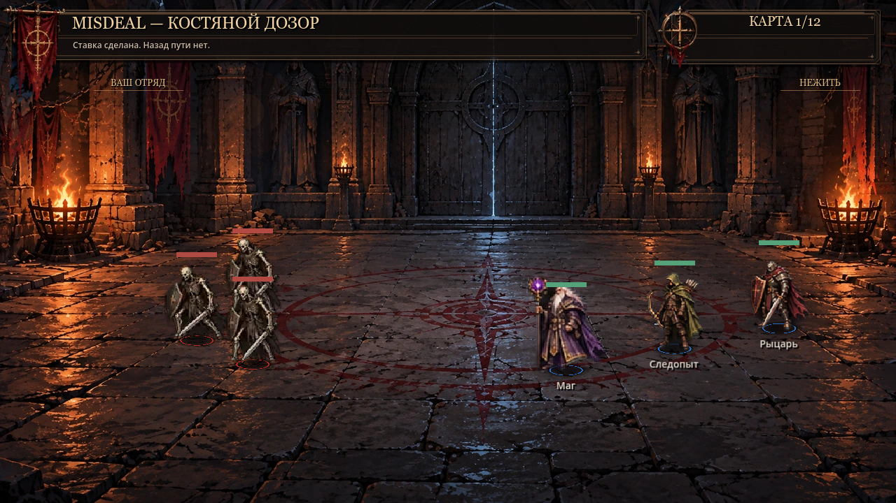

# D410 — C3 real-combat facing and silhouette continuity

Status: [PR #78](https://github.com/zampolit73/Misdeal/pull/78) OPEN on `fix/d410-c3-combat-animation-final-qa`; player artistic acceptance remains OPEN. Implements [issue #77](https://github.com/zampolit73/Misdeal/issues/77). Native local Godot **4.7.2.stable.official.ed1daf0bf**, NVIDIA OpenGL renderer, 1280×720. [Godot PR CI SUCCESS](https://github.com/zampolit73/Misdeal/actions/runs/42508837142), tested code `a7cd830b`: **206/206 GUT**, 44 scripts, 46,487 assertions; eight D410 fixtures and relevant scene smokes passed, GPU screenshots uploaded. Full authored RELEASE matrix was skipped.

## Evidence and scope

D398 WALK gallery, D404 moving/stopping/reversing real BattleUnits, and the production `scenes/battle/battle.tscn` were rendered locally. The battle used real RunState Knight + Ranger + Mage, Bone Patrol UnitData, normal preparation, `_on_fight_pressed()`, AI, damage and animations. These are native framebuffer captures, **not a manual keyboard F5 playthrough or player approval**.

The D409 Knight is visibly grounded in both walk directions. His source remains an oblique illustrated view; the capture does not justify announcing a newly redrawn upright/front-facing character. D410 therefore preserves **all source sprite bytes**, including six distinct D409 WALK overrides, D406 grip, D407 crystal and D408 HIT weapons. No source-pixel shifts, new sprite offsets, squash/rotation or new art direction were introduced. **Sustained posture/perspective quality still needs the player's judgment.**

A separate reproducible runtime defect was confirmed: `_process()` oriented the sprite before choosing a new target, then moved/attacked with the old facing for that frame. With the real battle's starting positions reversed in a QA-only fixture, all three heroes looked right while their acquired enemies were left. After D410 they face left in the same acquisition frame. The existing 12px horizontal dead zone remains.

| Before (main `87861a1`) | After D410 |
| --- | --- |
|  |  |

The image comparison freezes one real acquisition update; it does not imply a persistent multi-second defect. `first_acquisition.json` from each capture also records `target_left=true`, with `flip_h=false` before and `true` after for all three heroes. Capture runner seeds the battle's idle phases identically. Reversed positions are a dev fixture, never a change to an authored encounter.

Another confirmed defect: a C3 attack/HIT/DEATH could replace ArtSprite after RimSprite had already been synced, leaving the previous pose/mirror as a one-frame ghost silhouette. D410 synchronizes C3 one-shot changes immediately, the new facing immediately, final movement/attack transforms at the end of the update, and lethal reset transforms before rendering. Legacy/v2/enemy update sequencing is unchanged.

## Files and rollback

- `scripts/battle/unit.gd`: C3-only same-frame target facing and rim synchronization; 14 added lines, no AI/target selection/stat/damage/cooldown changes.
- `tests/unit/test_d410_c3_combat_facing.gd`: actual first movement, dead-target reacquisition and instant attack in both directions for all heroes; immediate HIT/DEATH texture; stable facing dead zone; legacy update order.
- `scripts/dev/d410_c3_combat_playtest.gd` + `scenes/dev/d410_c3_combat_playtest.tscn`: F6 launcher into the real Battle, solo role/trio and optional left enemy fixture; no alternate gameplay renderer.
- `scripts/dev/d410_c3_combat_smoke.gd`: eight real launcher → Battle fixtures, solo/trio × normal/left. Added to battle-relevant PR CI.
- `scripts/dev/d410_c3_combat_capture.gd`: repeatable native rendered evidence and exact live SpriteFrames export. Invoke without `--headless`, with `-- <absolute-output-dir> [left]`.

Rollback: revert this PR's `unit.gd` additions. Source atlases, D409 poses and their original fallback stay untouched. The F6/capture helpers are development-only and not referenced by production scenes.

## Verification

- New regressions before fix: **3 failing / 4 tests**; after fix: **4/4, 88 assertions**.
- Full local GUT: **206/206, 44 scripts, 46,487 assertions**, no skipped parse-error test. Existing 19 warnings retained.
- Native new scene smoke: **8/8 real launcher/Battle fixtures PASS**, all three solo roles + trio, both sides. Real D398/D404 galleries and Bone Patrol were rendered by GPU.
- Clean tracked snapshot import: exit 0, **no GDScript parse/collection errors**. Windows logs still contain pre-existing root certificate-store failure and failed import of `assets/concepts/approved_battle_direction.jpg` (also present in baseline). The same JPEG error is present in the successful Linux CI import log. These are reported separately; no claim of a completely warning-free import. The player's existing reopened local obsolete D390 scene and Bone Shepherd dev-smoke diagnostics were preserved and excluded from the clean tracked snapshot.
- D404 12px/pose gait and stop hold, six distinct Knight WALK cels, D405 attack weights/instant damage, D406–D408 art/props, old enemy/v2 behavior are covered by the passing existing suite. No sprites or combat resources were edited.
- Native D291 battle and QA-hub smoke: **PASS** (`D291_BATTLE_DS3_NATIVE_PASS`, `OPT4_QA_HUB_PASS`). [PR CI](https://github.com/zampolit73/Misdeal/actions/runs/42508837142): **SUCCESS**, verified log `GUT_VERIFIED_PASS: 206/206 real tests`, D410 8-fixture marker, all relevant native smokes and GPU captures.

## One player review

After the PR is reviewed/merged and pulled, open `res://scenes/dev/d410_c3_combat_playtest.tscn`, **F6**. Select Knight, then trio. Test normal enemies and “Враги слева”; press the real fight button. Inspect upright/heavy appearance, planted boots, direction at the first step/retarget, sword/shield, bow and staff during attacks/HIT. F6 restarts the picker. The reversed fixture disables deployment dragging so the original left-side placement clamp cannot snap its heroes back.

Use existing `res://scenes/dev/d404_c3_walk_motion_preview.tscn` for complete stop/reversal cycles; D398 AUTO for all five source states. Finish with **F5** normal gameplay combat → Reward → Table. If the Knight still reads hunched/back-turned over sustained walking, report that explicitly: **D410 does not claim a perspective redraw or close that artistic gate**. Only a confirmed source-art defect should trigger further localized artwork changes. Keep approved cadence/style.
