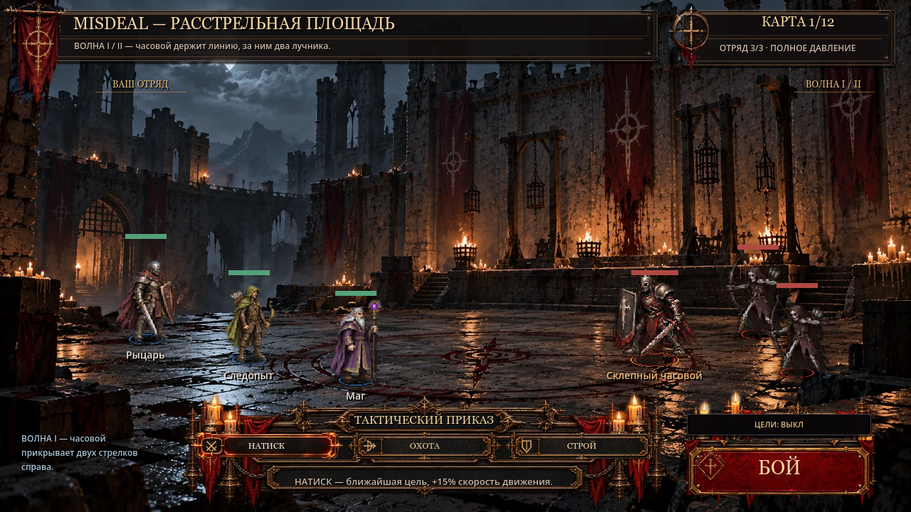
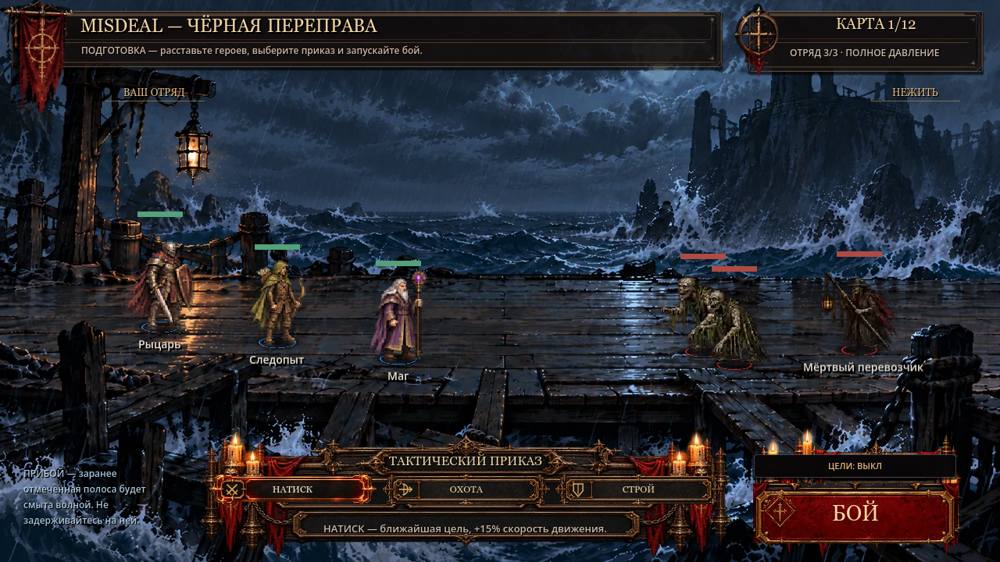
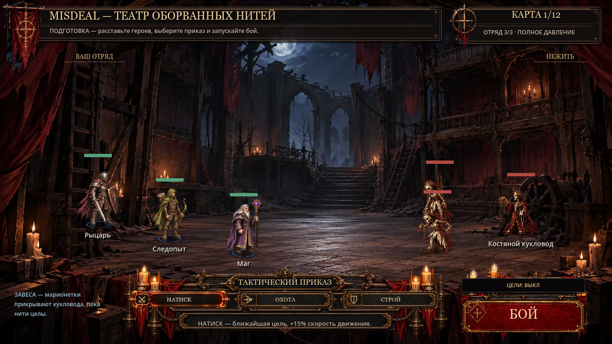

# Living Arenas — three-pilot delivery

## Scope and art lock

The requested castle courtyard is **`firing_square`**, the approved Расстрельная площадь (same real two-wave encounter). Other pilots: `black_crossing` (Чёрная переправа / Последний причал) and `threadbare_theatre` (Театр оборванных нитей / Ветхий театр).

No artwork was repainted. The three exact production source SHA256 values are recorded in [source_hashes.json](qa/living_arenas/source_hashes.json) and checked by GUT. No sound, new props, characters, geometry, balance, card, save, hero animation or global DS3 changes. Existing blue tide hazard/warnings seen in pier combat captures are the **unchanged gameplay overlay**, distinct from the new distant sea animation.

| Pilot | Local motion | Limits |
|---|---|---|
| Courtyard | Haze in the far passage; existing brazier/candle light; eight sparse dust grains in illuminated areas | No front-of-actor overlay; light modulation at most 4%; haze opacity at most 5.5% in its mask |
| Pier | Three phase-offset localized wave packets grow/crest/recede; brighten existing painted foam; rare soft cloud illumination | At most 2 px vertical water displacement; no translated rectangle; background water ends above y350; cloud variation at most 2.8%, about 31 s period |
| Theatre | Interior folds of existing heavy curtains; existing candle light and eight sparse motes | At most 1.7 px horizontal cloth motion, slower at attachment points; architecture and central stage fixed |

## Implementation

Extend the existing `BattleBackdrop` / `authored_backdrop.gd`, keeping its original texture/cache and scene ordering. One ShaderMaterial samples the original painting and a 320×180 RGBA region mask. `living_arena_profile.gd` holds three coordinate profiles traced against 1280×720 source plates: R displacement, G distant atmosphere, B existing light falloff, A dust. The reproducible offline baker is `scripts/dev/bake_living_arena_masks.gd`; source PNGs under `assets/pixel/battle/living_masks/`. The alpha channel is data, not visual transparency; masks use Godot’s Image resource importer to preserve all four channels and export correctly.

`set_arena_id` configures a pilot material only for those three IDs; other arenas retain the existing renderer. Duplicate legacy fog/birds/theatre dust in `battle_visual.gd` are skipped for the pilots. No new effects tree and no RNG consumption. Three cached textures total; no per-frame texture/node/Tween creation, bounded eight analytic particles. Time uses delta and a local uniform, not global shader TIME. No clock wrap/reset jumps during play.

Public backdrop controls: `set_living_enabled(bool)` restores/removes the material without changing the source texture, `set_living_paused(bool)` freezes local motion, `finish_living_arena()` freezes motion on the actual battle-finished hook. SceneTree pause is inherited. Toggle cannot accidentally resume a finished battle. A scene change resets only its own atmosphere clock. Masks follow texture UVs and viewport scaling; no HUD/actor transform changes.

## Native QA and evidence

Godot **4.7.2 stable**, GL Compatibility, 1280×720, Windows/NVIDIA RTX 3050 Laptop. Actual production Battle instances, actual fight-button signal, trio with original enemies; separate solo/trio/crowd benchmarks (crowd adds five existing enemies in QA only). The source files and game UI are not mocked.

- 327 native lossless frames: per arena original, animated, 96-frame / 8-second fixed-time motion sequence, preparation A/B, eight real combat frames, battle-end frame. Three additional native 960×540 resize captures.
- Actual SceneTree pause/resume and battle-end clock assertions; twelve create/switch/free GUT cycles; five warmed post-free reopen measurements per arena.
- Sampled pixel comparison: courtyard 5,515 changed samples; sea 1,080; theatre 3,009. **Zero changed protected-floor samples** on all three (two-pixel sampling). A separate mask test scans the full protected pier band. Every living pier unit is also checked against `black_crossing_floor` during native combat.
- Full GUT: **265/265**, 57 scripts, **71,284 assertions**; 19 existing warnings. Previous main: 260 tests. Five new behavioral regressions cover all 16 IDs, immutable art, pause/toggle/finish/reopen/cache/RNG, and identical fixed-step actual battle completion/winner/wave/unit HP/positions with effects on/off on all three pilots.
- CI selector: 16/16. Changes to Living Arenas force full RELEASE, including the existing route/UI/arena matrix and new native capture + pixel audit; full logs and complete sequences are uploaded even on failure.

[Compact native gallery](qa/living_arenas/index.html) · [capture manifest](qa/living_arenas/metrics.json) · [pixel audit](qa/living_arenas/pixel_audit.json). The repository keeps original/after, first/last motion, combat, completion and resize frames. All 96 motion frames per arena are kept locally and in the RELEASE `misdeal-smart-qa-evidence` artifact under `visual/living-arenas`. The HTML player operates on these actual frames; it does not synthesize movement. Compact checkouts explain how to regenerate the sequence. The inspection browser's file-URL policy prevented automated playback of the HTML gallery; direct Godot captures were inspected instead. User artistic review of native motion remains the gate for expansion.

Representative native combat/preparation:





## Performance

[Dedicated capture-free measurements](qa/living_arenas/performance.json), uncapped, VSync disabled. Per case: 1.1 s warm-up, at least 160 frames and 1.5 s observation; numbers below are **wall frame intervals**, not isolated GPU timings. Other applications remained open. Compare cautiously: active combat and desktop scheduling produce noise. Raw `process_median_ms` is Godot's coarser diagnostic monitor and is not used as a GPU cost estimate or acceptance metric.

| Arena | Scenario | Median ms OFF / ON | p95 ms OFF / ON |
|---|---|---|---|
| firing_square | empty | 3.18 / 2.44 | 6.35 / 5.24 |
| firing_square | solo | 3.25 / 3.26 | 7.00 / 6.64 |
| firing_square | trio | 3.68 / 3.15 | 11.42 / 6.14 |
| firing_square | crowd | 3.58 / 3.73 | 6.90 / 6.41 |
| black_crossing | empty | 2.25 / 2.27 | 5.18 / 5.04 |
| black_crossing | solo | 7.50 / 9.90 | 12.94 / 23.51 |
| black_crossing | trio | 4.97 / 3.48 | 11.48 / 7.77 |
| black_crossing | crowd | 4.39 / 5.18 | 11.81 / 9.04 |
| threadbare_theatre | empty | 4.61 / 3.01 | 9.87 / 9.93 |
| threadbare_theatre | solo | 5.57 / 4.84 | 13.65 / 10.68 |
| threadbare_theatre | trio | 5.58 / 4.19 | 13.13 / 10.21 |
| threadbare_theatre | crowd | 6.13 / 5.87 | 17.40 / 14.67 |

The initial solo-pier sample was noisy (p95 12.94→23.51 ms). Follow-up **12 A/B/B/A measurements**, six per setting, reproduced the same real solo battle without screenshot work: median-of-medians **7.13 ms OFF / 6.94 ms ON**, median p95 **11.46 / 10.55 ms**. [Unfiltered repeated results](qa/living_arenas/abba.json); script `scripts/dev/living_arenas_benchmark.gd`. No persistent effect-related slowdown was reproduced; faster ON samples are noise, not a claimed performance improvement. This is evidence for the tested laptop, not a universal low-end GPU guarantee. Linux software GL is also exercised by RELEASE CI.

After warm-up, each arena's five post-free reopening samples have identical node/object counts; static-memory growth is only about 788 bytes/measurement from retaining QA result dictionaries, about 3.2 KB across five entries. Mask cache stays at three. Video memory stays equal between OFF/ON for matched scenarios once cached; no accumulating particles, textures or Tweens.

## Local F6 / reproduction

Open one of:

- `scenes/dev/living_firing_square.tscn`
- `scenes/dev/living_black_crossing.tscn`
- `scenes/dev/living_threadbare_theatre.tscn`

Press **F6**, compare «Живой фон» OFF/ON and «Пауза фона», then **БОЙ** for the original encounter. ESC checks game pause. Check the sea behind the pier for at least 35 seconds, heavy curtain folds, distant courtyard passage, readability of units, tide warnings and HUD. Resize the window. These dev scenes use the existing no-save QA mode; no real save/profile is overwritten. In the ordinary game all three encounter IDs automatically use the same production backdrop behavior.

CLI, replacing `godot` with your Godot 4.7.x executable:

```text
godot --headless --path . -s addons/gut/gut_cmdln.gd -gdir=res://tests/unit -gconfig= -gexit
godot --path . --windowed --resolution 1280x720 --rendering-method gl_compatibility --audio-driver Dummy --script res://scripts/dev/living_arenas_capture.gd -- <absolute-output-dir>
godot --headless --path . --script res://scripts/dev/living_arenas_pixel_audit.gd -- <same-output-dir>
```

Capture-free benchmark: same capture command plus `--perf-only` after the output directory. The HTML/frames are QA artifacts, not imported game textures (`.gdignore` in that new QA directory only). Existing import metadata and user's local settings are preserved.

## Release and limits

Full RELEASE must be green on the final PR head before merge. No automatic rollout to any of the remaining thirteen arenas; the user must first approve the three pilots visually. Existing sea gameplay hazard artwork, enemy animation quality and unrelated art PRs remain separate tasks. The new system is silent and intentionally restrained.
