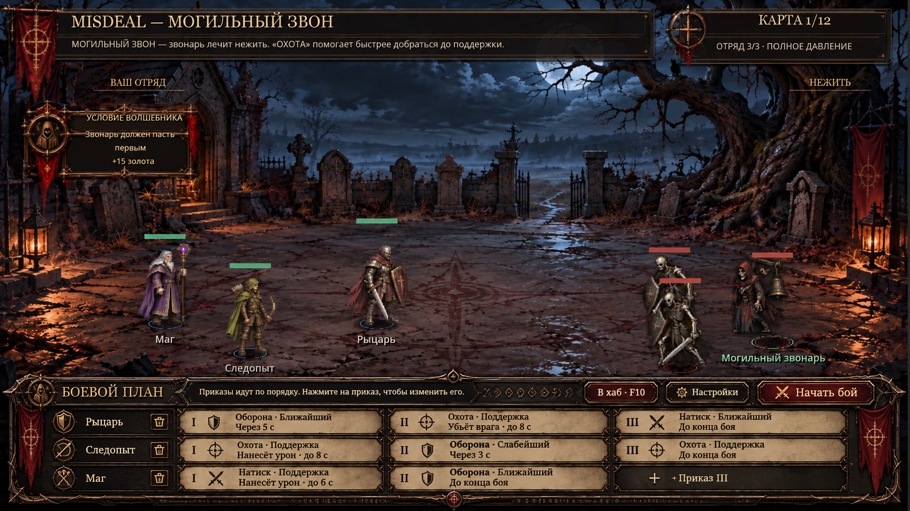
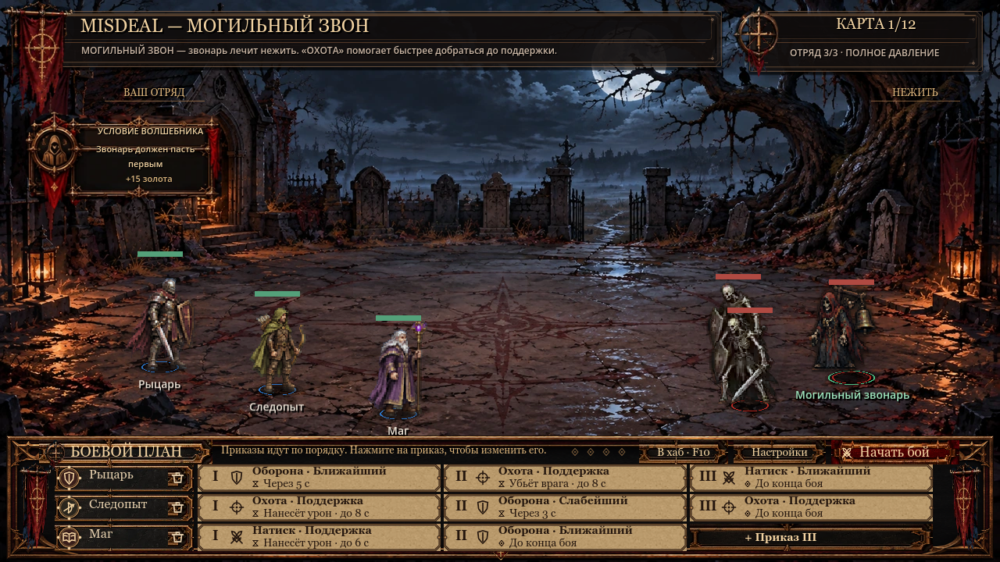

# Combat Planning Visual V4 — approved reference and Godot

## Approved visual reference

## Native Godot 4.7.2, 1280×720

| Reference detail | Godot V4 at 1280×720 |
|---|---|
| Bronze outer contour, corners and seals | Nine-sliced D413 dossier edge, D300 header seal and red cloth, small ruby seal on the bottom rail. The lines follow the live dock width. |
| Dark metal and parchment | D303 metal below the title and names. Each populated order has one bevel around a blank slice of the approved card parchment. The add slot stays dark. |
| Role and tactic symbols | Shield, bow and book medallions. A consistent set of ink glyphs marks orders, time, completion and assigned targets. Roman stage numbers are live labels. |
| Type and readability | Serif titles and dark text on paper. Assigned enemies use their own line so the Bellkeeper name fits. Long transitions use short labels and detailed editor help. |
| Buttons | Burgundy D303 fight plate with crossed blades. Dark metal for hub and settings. Press, hover, focus and selected states have live visuals. |
| Proportions and arena | The title, hero column, three order columns and side ribbons follow the reference. The dock is shallower than the proportionally scaled reference to keep the game's existing unit names clear. The arena, HUD and wizard objective use their existing positions. The title medallion uses the existing DS3 crest. |

[Order editor](visual_v4_edit_order.png) · [Target picker](visual_v4_target_select.png) · [Assigned target highlight](visual_v4_target_highlight.png) · [Solo](visual_v4_overview_solo.png) · [Duo](visual_v4_overview_duo.png) · [Actual combat](visual_v4_combat.png)

The approved image is included byte for byte from the user's attachment. Runtime UI uses individual approved DS3 texture regions and drawn shapes. Text, tooltips, values and state come from the live controls.

Native QA covers roster sizes, slot count, texture states, hover and press, target choice and highlight, start, battle HUD, result, retry, wave break and legacy parity. Full GUT passed 313/313. The 15 controlled fight records are identical to UX V3.1.
