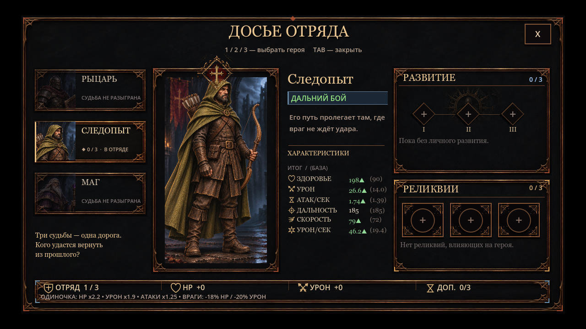
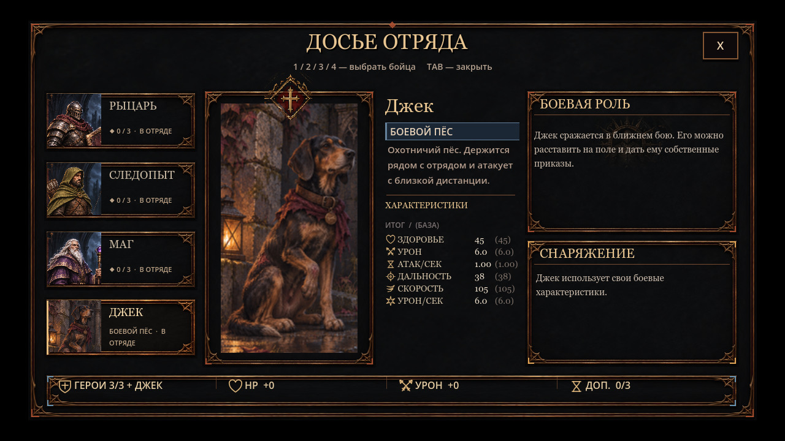
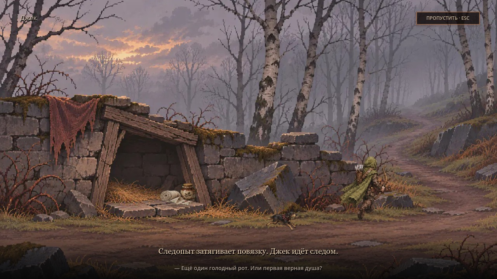
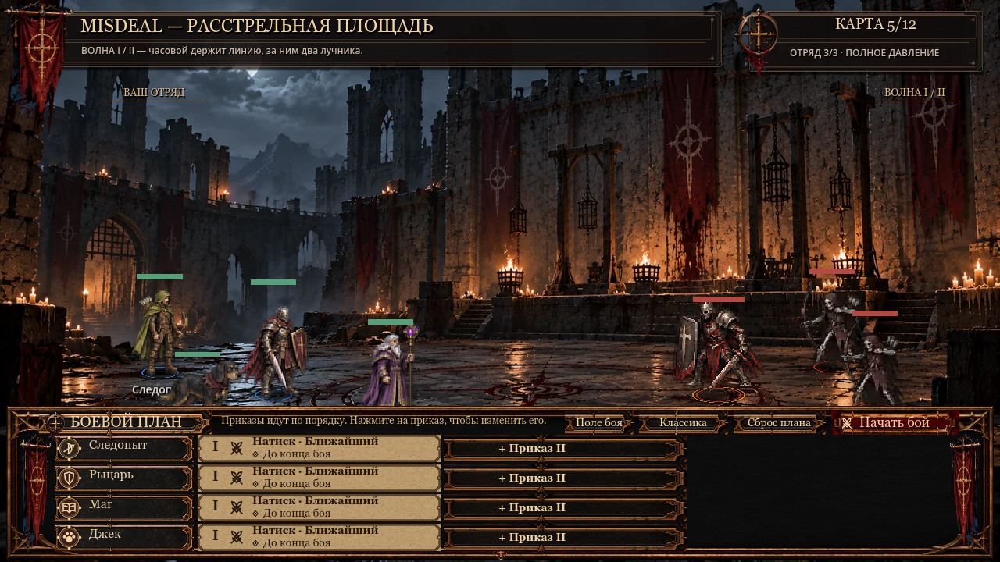

# Misdeal · Джек в отряде

Кадры Godot 4.7.2 в 1280×720. Нажмите на кадр для просмотра в полном размере. [PR №121](https://github.com/zampolit73/Misdeal/pull/121) · [Изменения `21dac23`](https://github.com/zampolit73/Misdeal/commit/21dac2347524ae47fbb1b1913ab35f1d139510dd)

## Досье отряда

| До найма | После найма |
| :---: | :---: |
|  |  |

## После выбора «Взять Джека»

Кадр из локального прогона Batch 03. Фон Джека использует ранний экспорт той же композиции. Масштаб, маршрут и спрайт соответствуют PR.

## Расстановка полного отряда

