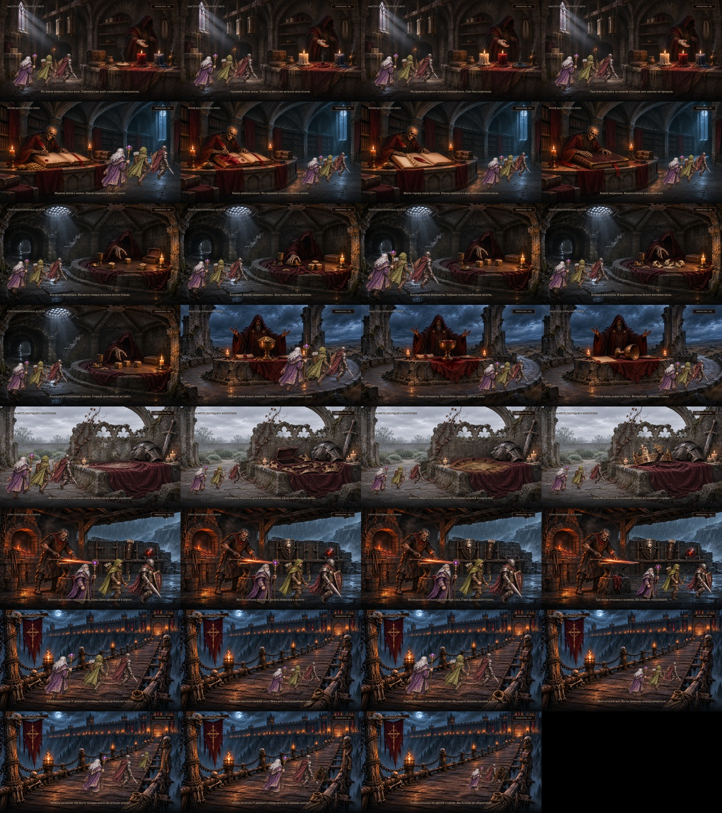

# Batch 02 V2 — native integration evidence

Real Godot 4.7.2 production TravelTransition overlays, not package paintings or browser mock-ups. The contact sheet includes all 31 actions, read left-to-right/top-to-bottom in [the package index](../../travel_batch02/OUTCOME_INDEX.md). Full-party screenshots preserve 1280×720; JPEG is QA-only. Runtime PNGs remain exact V2 bytes.

The actual event-route fixture separately pressed all 31 real choices (with deterministic seeds for both existing random branches), verified effects and completion exactly once, pause, repeated button/keyboard skip, natural finish and saved-Table reload with no travel replay. It captured 93 full-resolution frames. Additional full-party production rendering captured 93 frames; all full PNGs and logs are CI artifacts, not heavy Git assets.

| Corrected V2 action | Native frame | Native frame |
|---|---|---|
| `blood_ledger/gold` | [0.65 s](05_blood_ledger_gold_065.jpg) | [1.15 s](05_blood_ledger_gold_115.jpg) |
| `debtor_bones/safe` | [0.65 s](11_debtor_bones_safe_065.jpg) | [1.15 s](11_debtor_bones_safe_115.jpg) |
| `wizard_tithe/gold` | [0.65 s](14_wizard_tithe_gold_065.jpg) | [1.15 s](14_wizard_tithe_gold_115.jpg) |
| `broken_crown/wear` | [0.65 s](17_broken_crown_wear_065.jpg) | [1.15 s](17_broken_crown_wear_115.jpg) |
| `curse_forge/dead_mans_shield` | [0.65 s](21_curse_forge_dead_mans_shield_065.jpg) | [1.15 s](21_curse_forge_dead_mans_shield_115.jpg) |
| `curse_forge/blind_quiver` | [0.65 s](22_curse_forge_blind_quiver_065.jpg) | [1.15 s](22_curse_forge_blind_quiver_115.jpg) |
| `curse_forge/cracked_focus` | [0.65 s](23_curse_forge_cracked_focus_065.jpg) | [1.15 s](23_curse_forge_cracked_focus_115.jpg) |
| `rattling_bridge/rush_success` | [0.65 s](25_rattling_bridge_rush_success_065.jpg) | [1.15 s](25_rattling_bridge_rush_success_115.jpg) |
| `rattling_bridge/scavenge` | [0.65 s](27_rattling_bridge_scavenge_065.jpg) | [1.15 s](27_rattling_bridge_scavenge_115.jpg) |
| `rattling_bridge/recruit` | [0.65 s](29_rattling_bridge_recruit_065.jpg) | [1.15 s](29_rattling_bridge_recruit_115.jpg) |
| `rattling_bridge/loot_recruitment` | [0.65 s](30_rattling_bridge_loot_recruitment_065.jpg) | [1.15 s](30_rattling_bridge_loot_recruitment_115.jpg) |

Local full GUT and final-head CI status are recorded in [the integration contract](../../TRAVEL_BATCH02_V2.md). Local baseline certificate diagnostics and six route-shutdown ObjectDB diagnostics are not hidden; no new script/assertion failures in completed native captures.
